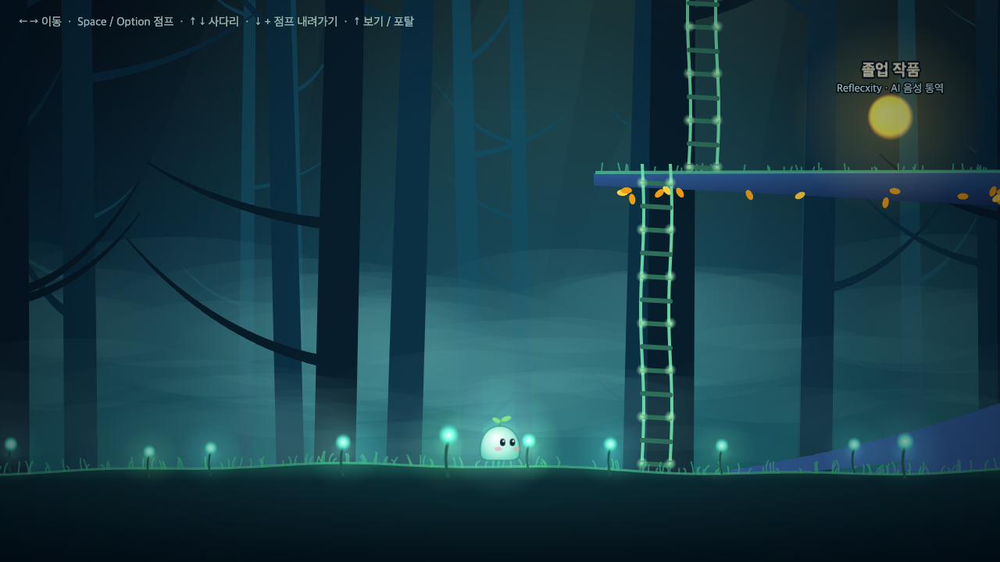

# 🌳 숲 포트폴리오

메이플스토리 엘로딘처럼 빛나는 숲을 **걸어 다니며 프로젝트를 구경하는 2D 포트폴리오**입니다.
이미지 에셋 없이 배경, 나무, 캐릭터를 모두 **캔버스로 직접 그렸습니다.**

**👉 [forest-portfolio-pi.vercel.app](https://forest-portfolio-pi.vercel.app)** (PC 키보드 환경 권장)



## 둘러보기

| 위치 | 내용 |
| --- | --- |
| 큰 황금 나무 1층 · 2층 | 프로젝트 구슬 4개 (졸업 작품, 2차 프로젝트, 숲 포트폴리오, 메인 프로젝트). 구슬 앞에서 ↑ → 상세 팝업 |
| 나무 꼭대기 | 소개 구슬 (GitHub, 블로그, 이메일) |
| 꼭대기의 보랏빛 포탈 | **밤하늘 점프맵**: 구름을 밟고 달까지. 별똥별을 피하고, 클리어하면 방명록과 순위표에 기록을 남길 수 있습니다 |

## 조작법

| 키 | 동작 |
| --- | --- |
| ← → | 이동 |
| Space / Alt (Mac: Option) | 점프 |
| 사다리 앞에서 ↑ ↓ | 사다리 오르기 / 내려가기 |
| 발판 위에서 ↓ + 점프 | 발판 아래로 내려가기 |
| 구슬 · 포탈 · 표지판 앞에서 ↑ | 보기 / 이동 |
| ESC | 팝업 닫기 |
| 오른쪽 아래 🔊 | 배경음악 켜기 / 끄기 (처음엔 꺼짐) |

## 기술 스택

| 영역 | 기술 |
| --- | --- |
| 게임 화면 | Phaser 4 (Arcade 물리) |
| UI (팝업) | React 19, TypeScript, Vite |
| 그래픽 | Canvas 2D로 직접 그린 텍스처 + 패럴랙스 + 파티클 (이미지 에셋 없음) |
| 방명록 · 순위표 | Supabase (PostgreSQL + REST API + RLS) |
| 배포 | Vercel |

## 구조

```
                EventBus (open-project, open-about, open-guestbook, modal-closed)
   ┌──────────────────────────────┐          ┌──────────────────────────────┐
   │ Phaser (src/game)            │ ───────▶ │ React (src/components)       │
   │ Forest 씬 · Sky 씬            │ ◀─────── │ 프로젝트 · 소개 · 방명록 팝업    │
   │ 캐릭터, 물리, 카메라, 포탈       │          │                              │
   └──────────────────────────────┘          └──────────────┬───────────────┘
            │ preload                                        │ fetch (REST)
   public/projects.json, about.json                Supabase sky_records 테이블
```

| 폴더 | 내용 |
| --- | --- |
| `src/game/scenes` | `Forest`(숲), `Sky`(점프맵) |
| `src/game/objects` | `Player`: 이동, 점프, 사다리, 넉백 |
| `src/game/world` | 맵 배치, 캔버스 텍스처, 포탈·발판·상호작용·조작 잠금 등 두 맵이 같이 쓰는 코드 |
| `src/components` | React 팝업 (공용 `Modal` 틀 + 프로젝트 / 소개 / 방명록) |
| `src/lib/skyRecords.ts` | Supabase REST 호출 (순위, 최근 방명록, 쓰기) |
| `public/*.json` | 프로젝트, 소개 내용 (코드 수정 없이 내용만 바꿀 수 있게 분리) |
| `supabase/sky_records.sql` | 방명록 테이블과 RLS 정책 |

## 설계에서 고민한 것

- **Phaser와 React는 EventBus로만 대화한다.** 서로를 import하지 않아서 게임과 UI를 따로 고칠 수 있다. 팝업이 열린 동안에는 캐릭터 조작과 Phaser 키 입력을 잠그고, 닫히면 다시 푼다.
- **콘텐츠는 JSON, 위치는 코드.** 프로젝트 소개는 `projects.json`, 맵 좌표는 `layout.ts`에 두고 id로만 연결했다. 내용을 고치면 구슬 이름과 팝업에 함께 반영된다.
- **서버 없이 방명록.** Supabase가 테이블마다 만들어 주는 REST API를 `fetch`로 부른다. publishable 키는 브라우저에 공개되는 키라서, 권한은 **RLS**로 제한했다 (읽기와 쓰기만, 수정·삭제 불가). 이름 길이, 기록 범위 같은 규칙은 화면뿐 아니라 DB `check` 제약에도 둔다.
- **씬을 다시 시작할 때 상태 초기화.** Phaser는 씬 객체를 재사용하므로, 숲 → 점프맵 → 숲으로 돌아올 때 이전 상태가 남지 않게 `init()`에서 비운다.
- **조작감.** 코요테 타임, 점프 버퍼, 히트박스와 그림 분리, 위에서만 밟히는 발판. Mac 한글 입력 상태에서 Option 키가 인식되지 않는 문제는 `keyCode` 대신 `event.code`로 해결했다.

## 직접 실행하기

```bash
npm install
cp .env.example .env.local   # Supabase 주소와 publishable 키 입력 (없으면 방명록만 비활성)
npm run dev                  # http://localhost:8080
npm run build                # dist/ 에 배포용 파일 생성
```

방명록을 쓰려면 Supabase 프로젝트를 만들고 `supabase/sky_records.sql`을 SQL Editor에서 실행합니다.

## 작업 방식

기능마다 **이슈 → 브랜치 → PR**로 진행했습니다. 진행 기록은 [Issues](https://github.com/Luvys99/forest-portfolio/issues?q=is%3Aissue)와 [Pull Requests](https://github.com/Luvys99/forest-portfolio/pulls?q=is%3Apr)에 있습니다.

## 출처

- [Phaser React TypeScript Template](https://github.com/phaserjs/template-react-ts) (MIT)로 시작했고, 템플릿 예제 코드는 정리했습니다.
- 배경음악: **숲의 밤** · [Suno](https://suno.com)로 직접 제작 (화면 오른쪽 아래 🔊 버튼으로 켜고 끕니다)
